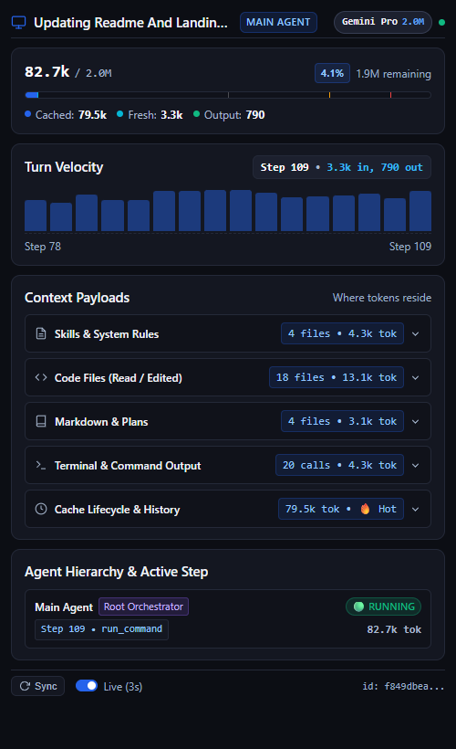
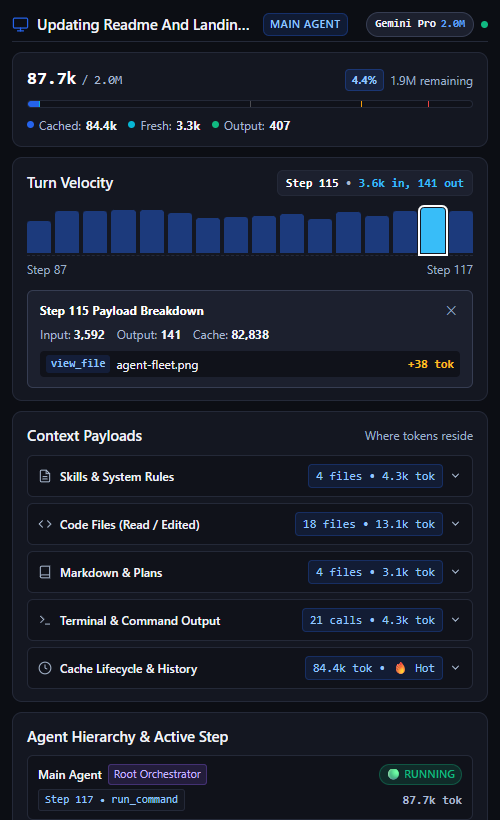
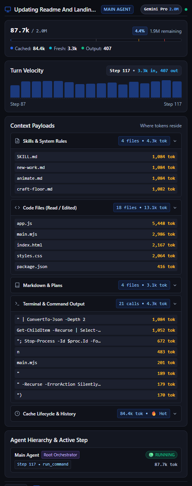
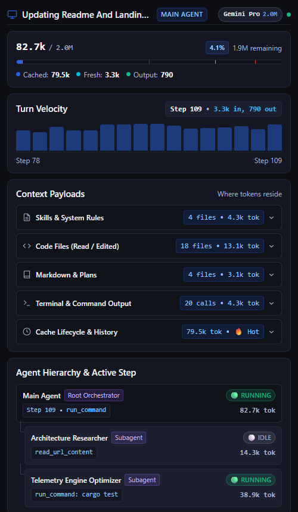
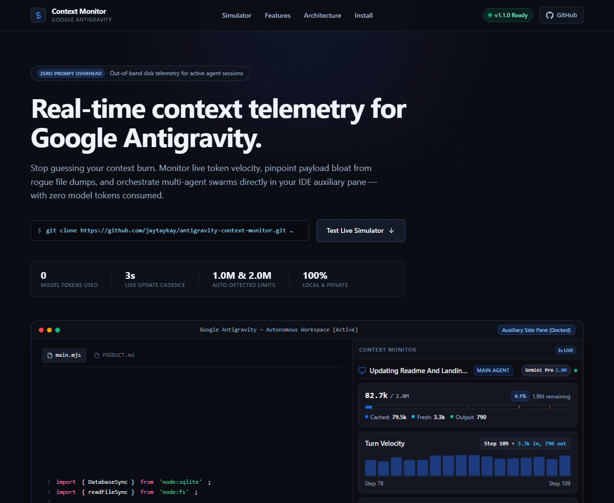

# Context Monitor for Google Antigravity

[](https://opensource.org/licenses/MIT)
[](https://nodejs.org/)
[](https://github.com/jaytaykay/antigravity-context-monitor)
[](https://jaytaykay.github.io/antigravity-context-monitor/)

A real-time, non-interruptive context window gauge and token telemetry monitor for **Google Antigravity**.

Docked directly in the Antigravity auxiliary side pane, Context Monitor tracks live context consumption, in-graph turn token velocity, payload breakdowns by category (Skills vs Code vs Docs vs Terminal), and multi-agent hierarchy — with **zero prompt interruptions** and **0 model tokens consumed**.

<p align="center">
  
</p>

---

## ⚡ Key Features & Interface Tour

### 1. Zero Token Overhead & Auto-Detected Limits
Queries local disk transcripts (`transcript.jsonl`) and session SQLite summaries out-of-band. Never consumes API tokens or model prompt budget. Context limits automatically detect active model settings (**Gemini Flash 1.0M** vs **Gemini Pro 2.0M**) without requiring manual configuration toggles.

---

### 2. Interactive Turn Velocity Graph & Step Inspector
Features a 16-step interactive sparkbar chart tracking per-turn token velocity. Hovering any bar updates the telemetry readout directly inside the graph header. Clicking a bar opens the **Step Inspector Drawer** to pinpoint specific tool payloads, file reads, or command outputs responsible for token spikes.

<p align="center">
  
</p>

---

### 3. Progressive Payload Attribution
Interactive accordions reveal where context tokens reside across your session:
- **Skills & System Rules:** `SKILL.md` instructions and tool declarations.
- **Code Files:** Source code files read and edited (`.js`, `.mjs`, `.ts`, `.py`, `.css`, etc.).
- **Markdown & Plans:** Specs, plans, and documentation (`README.md`, `PRODUCT.md`, etc.).
- **Terminal & Command Output:** Shell commands and compiler/test outputs.
- **Cache Lifecycle & History:** Prompt cache hit rate, elapsed time, and warm discount countdown.

<p align="center">
  
</p>

---

### 4. Agent Fleet & Subagent Swarm Tracking
Provides end-to-end visibility into root orchestrators alongside active child subagents, their execution states (`RUNNING` / `IDLE`), active tool executions, and individual context usage.

<p align="center">
  
</p>

---

## 📋 Prerequisites

- **Google Antigravity IDE**
- **Node.js >= 22.5.0** (uses built-in `node:sqlite` for reading conversation summaries; no external dependencies required)

---

## 🚀 Installation & Setup

### 1. Install as an Antigravity Plugin

Clone the repository into your Antigravity plugins directory:

#### Windows (PowerShell)
```powershell
git clone https://github.com/jaytaykay/antigravity-context-monitor.git "$env:USERPROFILE\.gemini\config\plugins\context-monitor"
```

#### macOS / Linux
```bash
git clone https://github.com/jaytaykay/antigravity-context-monitor.git ~/.gemini/config/plugins/context-monitor
```

> **Note:** If you install while Antigravity is open, restart the app to discover the new plugin directory.

### 2. Using in Antigravity

- **Via Extensions Menu:** Click **⋮ (Extensions)** $\rightarrow$ select **Context Monitor**.
- **Via Chat Pill:** Click [`[Context Monitor]`](sidecar://context-monitor/panel/) in any conversation.
- **Via Slash Command:** Type `/context-monitor` in chat to summon the toggle link.

The panel docks in your auxiliary side pane and updates automatically every 3 seconds as your agent works.

---

## 🖥️ Standalone Browser Preview & Landing Page

You can also run Context Monitor independently in any web browser to inspect local sessions, test the sidecar UI, or view the product landing page:

```bash
git clone https://github.com/jaytaykay/antigravity-context-monitor.git
cd antigravity-context-monitor
npm start
```

- **Live Sidecar Monitor:** [http://127.0.0.1:3456/](http://127.0.0.1:3456/)
- **Live Hosted Site (GitHub Pages):** [https://jaytaykay.github.io/antigravity-context-monitor/](https://jaytaykay.github.io/antigravity-context-monitor/)
- **Local Landing Page:** [http://127.0.0.1:3456/landing](http://127.0.0.1:3456/landing) (or open `docs/index.html` directly)

<p align="center">
  
</p>

---

## 📂 Repository Structure

```text
context-monitor/
├── assets/
│   ├── logo.svg                 # Plugin logo for Antigravity UI
│   └── screenshots/             # Interface tour captures
│       ├── overview.png         # Main auxiliary panel overview
│       ├── turn-velocity-inspector.png # Step inspector breakdown
│       ├── payload-attribution.png     # Categorized token attribution
│       ├── agent-fleet.png      # Multi-agent swarm tracking
│       └── landing-page.png     # Interactive showcase & simulator
├── docs/                        # GitHub Pages deployment & landing site
│   ├── index.html               # Responsive high-craft showcase
│   ├── styles.css               # Obsidian telemetry theme & animations
│   ├── script.js                # Live telemetry simulator & interactions
│   └── assets/                  # Deployed web assets & screenshots
├── sidecars/
│   └── panel/                   # UI extension sidecar
│       ├── sidecar.json         # Sidecar process & aux pane manifest
│       ├── main.mjs             # Node backend (transcript & SQLite telemetry)
│       ├── index.html           # Monitor panel HTML markup
│       ├── app.js               # Frontend controller & reactive state
│       └── styles.css           # High-density panel styling
├── skills/
│   └── context-monitor/
│       └── SKILL.md             # /context-monitor skill & navigation pill
├── plugin.json                  # Antigravity plugin manifest
├── package.json                 # Node package configuration
├── DESIGN.md                    # Design tokens & UI specifications
├── PRODUCT.md                   # Product architecture & requirements
└── LICENSE                      # MIT License
```

---

## 🧪 Verification & Testing

Verify syntax and script integrity with:

```bash
npm test
```

---

## 📄 License

[MIT](LICENSE) © 2026 jaytaykay
